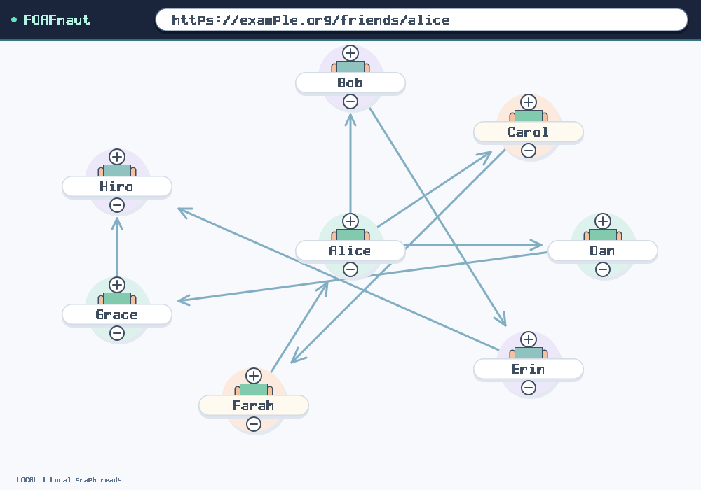

# FOAFNaut: one Lean layout policy, exported as SVG



[Open the SVG](foafnaut.svg) · [Policy report](foafnaut.svg.policy.json) · [Provenance and hashes](provenance.json) · [Turtle input](demo.ttl)

This static graph contains eight people and nine links from the Factoidal RDF
parser. Lean generates the drawing geometry and checks each visible node's
footprint before exporting the SVG. The native SVG frontend also accepts this
exact file and compiles it to 1,880 GPU primitives. This report publishes the
SVG and CPU compilation evidence; it is not a new GPU capture.

The selected overlap limit is **5%**, with an application range of **3–7%**.
For each node, the metric sums its pairwise intersections with other node
bounding boxes, clipped to the viewport. Every node in this export has zero
such intersection. Edges and browser controls are excluded from that metric;
it is not a measurement of painted-pixel overlap.

The configured check rate is **12 Hz**, within the application's **12–24 Hz**
range. This static export is checked once. It does not demonstrate a live
checking schedule or a real-time guarantee. The interactive demo's ordinary
frames still report diagnostic checks rather than enforced presentation.

The same Lean policy definition supports checked SVG and checked native scene
exports. Application bounds are kept separately from the caller-editable scene
model, so changing the model cannot widen the expected application policy.
These experimental parameter limits are human-designed defaults, not a proven
universal measure of usability.

Source: [core commit b2888a06](https://github.com/danbri/factoidal-core/tree/b2888a06b1989112ab99b10eb4f4e12f8d1ce582/labs/demos/foafnaut).
[Policy design and proof scope](https://github.com/danbri/factoidal-core/blob/b2888a06b1989112ab99b10eb4f4e12f8d1ce582/docs/designissues/2026-10-30-shared-ui-policy.md).
[Source PR](https://github.com/danbri/factoidal-core/pull/271) and
[binary pipeline PR](https://github.com/danbri/factoidal-builds/pull/9) remain separate
from this results publication. The native window package currently targets
macOS ARM64. Browser visual comparison and a fresh native GPU capture remain
outstanding. SVG standards coverage is reported separately in the parent gallery.

Reproduce with the matching compiled package:

```sh
./native-webgpu-ui-darwin-arm64 --demo foafnaut --rdf demo.ttl --emit-svg foafnaut.svg
./native-webgpu-svg-darwin-arm64 foafnaut.svg --emit-artifact native-plan.json
```

The font in this SVG is the temporary Lean vector-cell font. Unsupported
characters in names still need a proper Unicode font/text implementation.
